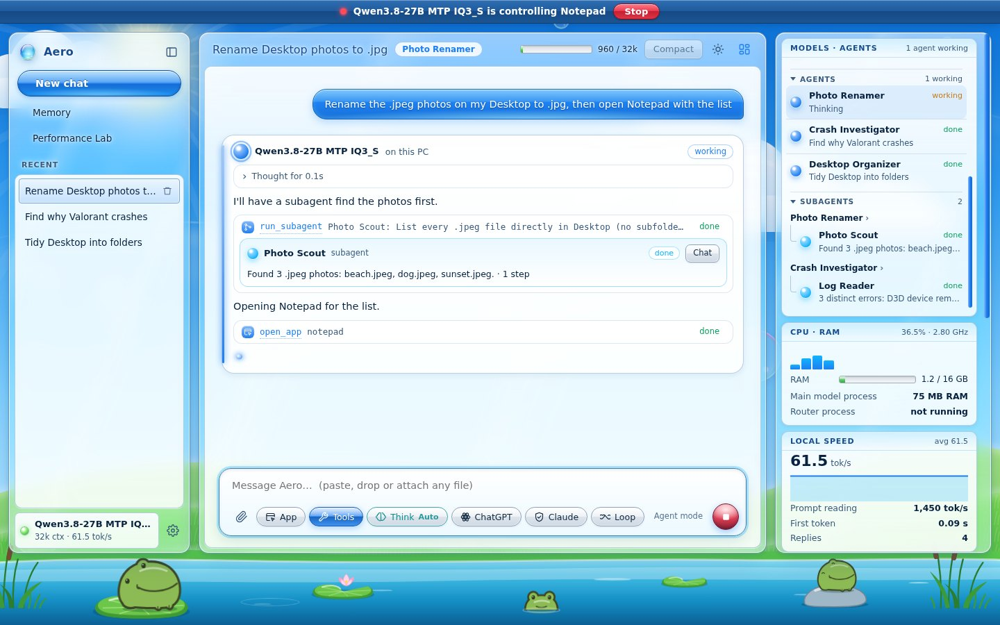
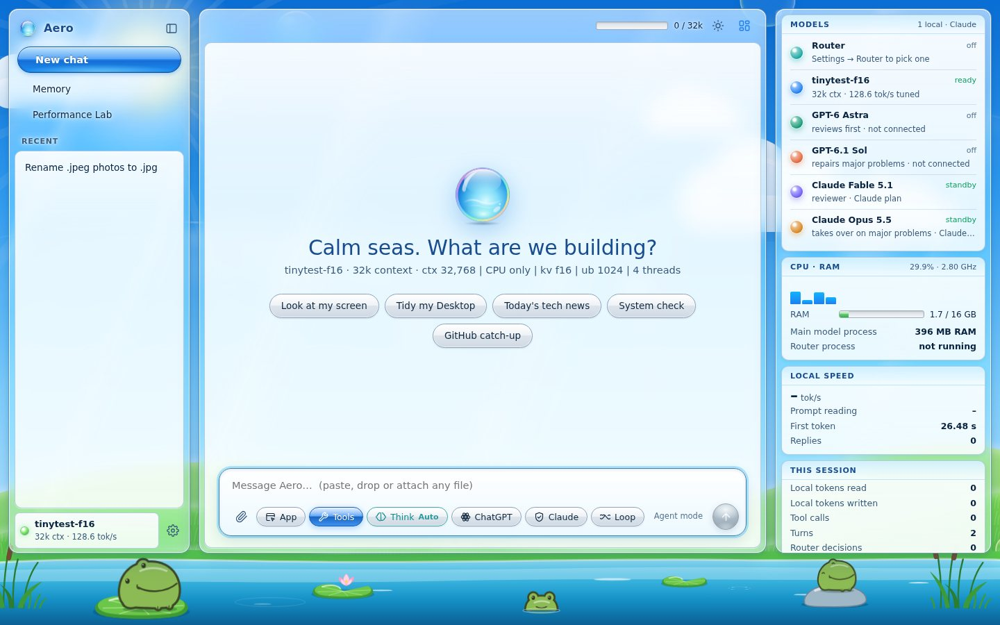
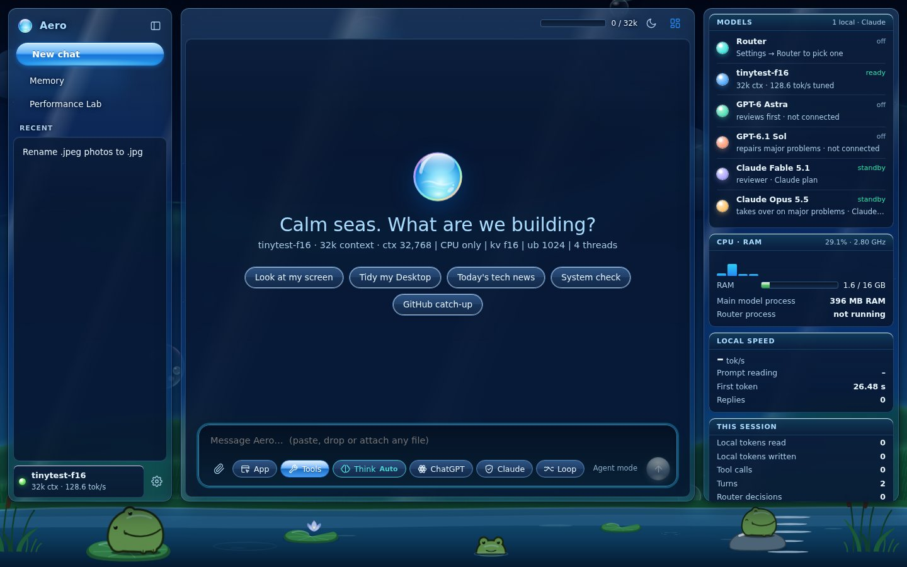
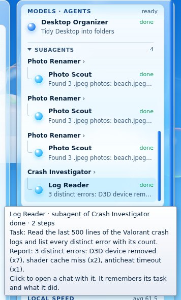
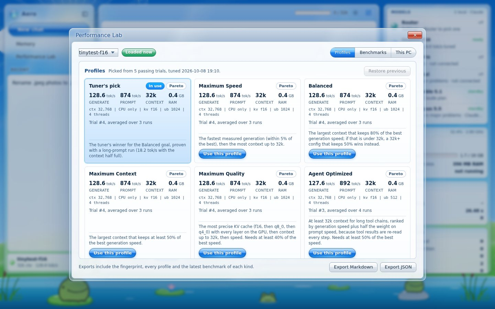

<div align="center">

# Aero

**Your own AI, running on your own computer.**<br>
A local AI workstation for Windows, Linux and macOS, wrapped in Frutiger Aero glass.

[](https://github.com/NermalYT/Aero/releases/latest)
[](https://github.com/NermalYT/Aero/actions/workflows/ci.yml)
[](LICENSE)

[**Download**](https://github.com/NermalYT/Aero/releases/latest) ·
[**Quick start**](#quick-start) ·
[**Manual**](#manual) ·
[**What's new in 1.2.75**](#whats-new-in-1275) ·
[**FAQ**](#faq)



</div>

## What is Aero?

- **A chat app for AI that runs on your PC.** No account, no subscription. Your chats and files stay on your computer.
- **It sets everything up for you.** Aero looks at your hardware, suggests a model that fits, installs the right
  engine for your graphics card and tunes it until it runs as fast as your machine allows.
- **The AI can actually do things.** With your permission it reads and writes files, runs commands, uses apps and a
  browser, writes code, builds Flutter apps, makes images and diagrams, reviews code, and more.
- **It runs models bigger than your graphics card.** A 70-billion-parameter model on a 16 GB card, or a 27B model
  in about 3 GB of VRAM.
- **Cloud is optional.** You can have ChatGPT or Claude double-check the finished work, but you don't need to.
  Turn on **strict offline** and nothing leaves your computer at all.

## Quick start

1. Download the file for your system from the [latest release](https://github.com/NermalYT/Aero/releases/latest).
2. Install it:

   | Your system | Download | Do this |
   | --- | --- | --- |
   | **Windows** 10 / 11 | `Aero-windows.zip` | Extract the zip, double-click **`Update-Aero.bat`**, say yes to the admin prompt. |
   | **macOS** (Apple Silicon or Intel) | `Aero-macos.zip` | Unzip, right-click **`Install-Aero.command`** → **Open**. |
   | **Linux** (any distro) | nothing, use the terminal | `curl -fsSL https://github.com/NermalYT/Aero/releases/latest/download/install.sh \| sh` |
   | Debian / Ubuntu / Mint / Pop!_OS | `aero_<version>_all.deb` | `sudo apt install ./aero_*_all.deb` |
   | Fedora / RHEL / Rocky / Alma / openSUSE | `aero-<version>-1.noarch.rpm` | `sudo dnf install ./aero-*.rpm` (openSUSE: `sudo zypper install ./aero-*.rpm`) |
   | Arch / Manjaro / EndeavourOS | `PKGBUILD` | `makepkg -si` |

3. The installer asks you to pick two models (a tiny "router" and your main model). **Press Enter twice** to take
   the recommended ones.
4. Aero opens. Type a message. That's it.

> **New to local AI?** A *model* is the AI's brain, a file of a few GB. Bigger models are smarter but need more
> memory. Aero's chooser only recommends models that fit your PC, so you can't pick a wrong one by accident.

## What you need

| | Minimum | Comfortable |
| --- | --- | --- |
| **System** | Windows 10/11 64-bit, macOS (Apple Silicon or Intel), or any Linux with Python 3.10+ | |
| **Memory (RAM)** | 8 GB (small models) | 16 GB or more |
| **Graphics card** | None needed (runs on the CPU) | NVIDIA, AMD, Intel or Apple Silicon: much faster |
| **Disk** | A few GB for the app, plus 2–30 GB per model | |
| **Internet** | For the install and model downloads | Not needed afterwards |

## What it can do

| Feature | In plain words |
| --- | --- |
| 🧠 **Fits any PC** | Reads your GPU, RAM and CPU and recommends the best model that fits: fully on the GPU, split with RAM, or CPU only. |
| ⚡ **Tunes for real** | Measures settings on *your* machine within a memory limit you choose, then saves the fastest, and tests how well the model calls tools so Aero can set it up for agent work. Profiles: Maximum Speed, Balanced, Maximum Context, Maximum Quality, Agent Optimized, Efficiency. |
| 🧭 **Smart router** | A tiny model reads each message first and gives the main model only the tools it needs: faster and cheaper on memory. |
| 🛠️ **An agent that does things** | Files, shell, screenshots, other apps, a browser, web search, memory, skills, MCP servers and GitHub. "Check my emails for meetings this week" just works: Aero works out the steps, does them on screen where you can watch, and hands you the result. Risky actions ask you first. |
| 🗂️ **Workspaces** | Ten built-in work areas: Code, Mobile apps, Create (images), Diagrams, Review & test, Debug & reverse, Finance, Library, Memory+, Big models. They open by themselves when you ask for that kind of work. |
| 🐘 **Big models on small GPUs** | Search any model of any size: Aero picks (or makes) the quant that fits, the tuner places every part of it between GPU and RAM, and a small "draft" helper speeds it up. Full-precision models run through AirLLM. |
| 🤖 **Autonomy** | Choose per chat: ask me every time, collect the questions while you keep working, or full auto with a safety model that says yes or no. |
| ♾️ **Forever-loop** | Repeat a task until you press Stop; the AI keeps a journal and gets better each round. |
| 👥 **Agents and subagents** | Each task gets a named agent ("Photo Renamer"); big jobs are split across subagents you can chat with. |
| 🪟 **Works in other apps** | Finds apps by name ("open my Bloxstrap"), works in the background, and never touches your mouse or keyboard without asking. |
| ✅ **Optional cloud review** | ChatGPT and/or Claude check the finished work and fix it; your local model learns from their findings. |
| 🔒 **Privacy switches** | **Local Only** keeps a chat on your PC; **strict offline** blocks all network traffic and logs every attempt. |
| 🧪 **Performance Lab** | Real benchmarks: speed, long-context recall, tool-call accuracy, and what the scenery costs. |
| 🧩 **Mod Aero** | Describe a change to Aero in plain words; your model makes it in a test copy, which Aero checks before you apply it. |
| 🐸 **Frutiger Aero look** | Glass panels over a living day/night landscape with a frog pond. Full, Still or Off. |

| Day | Night |
|---|---|
|  |  |

## What's new in 1.3

Every feature was tested on a real PC for this release; what broke is fixed, and what was missing is added.

- **Voice typing.** A microphone button in the chat box: speak, and your words appear in the message box. It runs
  on your PC with whisper.cpp; attached recordings are transcribed too.
- **Text in images for models that can't see.** Attached images, scanned PDFs and screenshots are read with
  Windows' own OCR, so a text-only model still gets their text (and where each line is on screen).
- **Word documents.** Ask for a report or a letter as a Word file and get a real .docx.
- **Fixes from the testing**, among them:
  - a model tuned to fill the GPU no longer crashes on its second request;
  - "type into this box" in an app works (3 tool calls instead of 40 that never finished);
  - Mod Aero's checks pass again;
  - edits to Windows files keep their line endings.
  Full list in the [changelog](source/CHANGELOG.md), test results in [the 1.3 test report](source/docs/V1.3_TEST_REPORT.md).

## What's new in 1.2.80

- **Tuning that keeps improving.** A tune starts from what worked last time, and while your PC is idle Aero keeps
  tuning the loaded model one depth deeper. Send a message and it stops at once.

## What's new in 1.2.75

- **Tasks survive closing Aero.** If Aero closes in the middle of a job, it's listed under **Tasks**: one click
  resumes it, and the model knows what was already done.
- **Scheduled tasks.** "Every weekday at 8, check my email and GitHub": ask for it, or add it under Tasks. Each run
  lands in its own chat, and anything that needs your OK waits for you.

## What's new in 1.2.70

- **Long chats stay fast.** Your chat keeps its own slot in the model server, so background jobs no longer push it
  out of the cache. Its cache is also saved to disk, so after a restart Aero picks the chat up where it left off
  instead of reading it all again: 8,709 of 9,594 tokens reused in testing.
- **Parallel slots, cache reuse and a RAM prompt cache**, all in *Settings → Model & tuning*.

## What's new in 1.2.65

- **Tuning settings.** Every setting the tuner uses can stay automatic or be pinned for a model:
  - context, and the KV cache for keys and values separately;
  - GPU or CPU placement, flash attention, batch sizes and threads;
  - memory mapping or locking;
  - longer context with YaRN.
- **Profiles one click away.** Each model card has *Profile…*: switch between the speed, balanced, long-context and
  quality setups Aero measured, without re-tuning.

## What's new in 1.2.6

- **Select.** Search any model on Hugging Face and click **Select**. Aero:
  - works out the best quant and setup for your PC before downloading;
  - downloads it, tunes it and loads it.

  A 4 GB GPU can select a 27B model and it runs (slowly, and Aero says so and suggests faster options). A
  mixture-of-experts model like Qwen3-30B-A3B runs at about 26 tok/s on that card.
- **No VRAM number to type** before tuning: Aero uses what's free, and **Change** is there if you want your own.

## What's new in 1.2.5

- **Aero has its own browser.** It never uses or touches your own browser. Settings → Tools → **Sign in to your
  accounts** opens Aero's browser as a normal window: sign in to your Chrome profile (profile icon → Turn on sync) or
  to single sites once, press **Done**, and Aero stays signed in. When a page needs a sign-in mid-task, the same
  window opens on that page.
- **See what it's using.** The app Aero is using gets a blue outline and a "*model* is using *app*" banner with
  **Stop**, on whichever monitor it's on.
- **Fixes from hands-on testing:** images 16.7 s instead of 8 minutes beside a big model, a calmer tuning advisor,
  no false "it's open", Hindsight starts on every PC. ([test report](source/docs/V1.2.1_HANDS_ON_TESTS.md))

## What's new in 1.2.1

- **Works in your own browser.** Aero uses your default browser (Chrome, Edge, Brave, Vivaldi), and with its
  remote-debugging switch on it works right in the browser you're signed in to: no second profile to sign in to.
  It opens its own tabs, never touches yours, and your browser asks before it connects.
- **Asks become actions.** Aero recognises requests that need doing ("look at my GitHub", "check my emails and look
  for meetings this week"), shows its plan, works on screen, pauses for you to sign in when a site needs it, and
  makes the first move itself when a small model would rather say "I can't".
  ([details](source/docs/V1.2_TOOL_CALLING.md))
- **Tool calling is tuned too:** every tune ends with a tool-calling exam (Berkeley function-calling cases plus Aero
  requests) that sets up the model for agent work.
- **Any model, any size:** search all of Hugging Face; Aero finds a GGUF version or makes its own, and the tuner
  places the parts that don't fit (Gemma-3-27B Q8 with 98k context on a 16 GB card).
- **Everything comes installed:** Hindsight, AirLLM, image generation, Flutter and the code tools are set up with
  Aero, not later.

1.2.0 brought the workspaces, autonomy modes, models bigger than your GPU and the faster router:
- **Workspaces with other projects built in.** Flutter apps with a live preview inside Aero, code checks for
  Python / JS / TS / Rust / Go, local image generation, diagrams, code review, end-to-end testing, a debugger,
  finance skills, curated libraries and memory banks. ([details](source/docs/V1.2_INTEGRATIONS.md))
- **Autonomy modes** for chats and forever-loops. ([details](source/docs/V1.2_AUTONOMY.md))
- **Big models:** Llama-3.3-70B at 4.85 tokens/s on a 16 GB card; Gemma-3-27B in 3.1 GB of VRAM; AirLLM for
  full precision. ([details](source/docs/V1.2_BIG_MODELS.md))
- **Faster router:** 1.6 s per decision on the CPU (was 2.8 s), about 0.4 s on the GPU.
- **Safer local API** and an installer you can point at any folder (`--dest`).

Full list: [CHANGELOG](source/CHANGELOG.md).

---

# Manual

Click a topic to open it. The complete reference manual, with every setting, is
[source/README.md](source/README.md); it also ships inside every install.

**Getting started:** [Installing](#installing) · [First run](#first-run-the-model-chooser) · [Your first chat](#your-first-chat)<br>
**Using Aero:** [Tools & permissions](#tools-and-permissions) · [Apps & desktop](#controlling-apps-and-the-desktop) · [Workspaces](#workspaces) · [Big models](#big-models) · [Autonomy](#autonomy) · [Forever-loop](#forever-loop) · [Agents](#agents-and-subagents)<br>
**More:** [ChatGPT & Claude](#chatgpt-and-claude-reviews) · [Privacy](#privacy-and-offline) · [Memory](#memory-and-your-profile) · [Performance Lab](#performance-lab) · [Mod Aero](#mod-aero) · [GitHub, MCP & skills](#github-mcp-and-skills) · [Updates & uninstall](#updates-and-uninstall) · [Folders & ports](#folders-and-ports) · [Troubleshooting](#troubleshooting) · [FAQ](#faq)

### Installing

<details>
<summary><b>Windows</b></summary>

1. Extract **all** of `Aero-windows.zip` (don't run it from inside the zip).
2. Double-click **`Update-Aero.bat`** and accept the admin prompt.
3. It works out what to do:
   - **Nothing installed:** installs into `C:\Aero`: Python 3.12 if needed, a private Python environment, the
     llama.cpp build for your GPU, and Start menu and desktop shortcuts. Aero appears in **Settings → Apps →
     Installed apps**.
   - **Aero already installed:** updates the app, its packages and llama.cpp. Models, chats and settings are kept.
   - **An older Halcyon or VRAMpire install:** moves everything to `C:\Aero` and keeps your data.
4. The model chooser runs, then Aero opens.

Want it somewhere else? `Update-Aero.bat --dest D:\Aero` (no admin needed outside `C:\Aero`).
</details>

<details>
<summary><b>macOS</b></summary>

Unzip `Aero-macos.zip`, right-click **`Install-Aero.command`** → **Open** (macOS asks the first time because the
file came from the internet). It installs Python 3.12 from Homebrew if you have no Python 3.10+, puts Aero in
`~/Library/Application Support/Aero`, adds **Aero.app** to `~/Applications` and the `aero` command. Apple Silicon
uses the Metal (GPU) build; Intel Macs use the CPU build. Desktop control asks for Screen Recording and
Accessibility permission the first time it's used.
</details>

<details>
<summary><b>Linux</b></summary>

```sh
curl -fsSL https://github.com/NermalYT/Aero/releases/latest/download/install.sh | sh
```

The installer finds your package manager (apt, dnf, zypper, pacman, apk, xbps, eopkg, emerge, swupd), shows the
command for anything missing (Python 3.10+, Vulkan loader, OpenMP) and **asks before** using sudo. Aero installs for
your user into `~/.local/share/aero` with an app-menu entry and the `aero` command, downloads the CUDA, Vulkan or CPU
build of llama.cpp (or compiles it on Alpine and ARM boards), runs the chooser and starts. `sh install.sh --help`
lists options such as `--yes`, `--skip-models` and `--dir`.

The `.deb`, `.rpm` and `PKGBUILD` install the `aero` command for everyone; each user's first start sets up their own
copy.
</details>

### First run: the model chooser

<details>
<summary><b>Picking your two models</b></summary>

The chooser shows what it found (for example *Radeon RX 9070 XT 16 GB · 32 GB RAM · Ryzen 7 9800X3D*), then:

1. **Decision router (runs on the CPU).** A small, fast model that reads each message first. The one marked
   **★ recommended for this PC** fits your RAM and cores. Aero benchmarks it on your CPU and keeps the fastest
   setting.
2. **Main model.** Each model is shown with the size that fits your memory, where it will run (*fully on the GPU*,
   *GPU + experts in RAM*, *on the CPU*, or *too big for this PC*) and its intelligence score. Press **Enter** for
   the recommended one.

Run it again any time: `C:\Aero\Update-Aero.bat` (Linux/macOS: `sh <install folder>/install.sh`), or change the
router in **Settings → Router**.
</details>

### Your first chat

<details>
<summary><b>Choosing a model, tuning, and chatting</b></summary>

1. Open **Aero** from the desktop or Start menu.
2. Pick a model: **Your models**, **Find a model on Hugging Face** (any model, any size; every quant is marked
   *fits* or *doesn't fit* this PC and the best one is recommended), or **Open .gguf file…**. A model that only has
   its original weights shows the GGUF versions others made of it, or **Make a GGUF here** (Aero converts and
   quantizes it for your PC).
3. **The first load tunes the model** (later loads skip this):
   - **VRAM limit:** the most graphics memory the model may use. Aero suggests one.
   - **Depth:** Short (10 trials), **Medium** (25), Long (50) or Full (keeps going until 8 trials in a row
     find nothing better).
   - **Goal:** Balanced, Max context or Max speed.
   - Every trial is a real measurement. The winner is saved for this model, GPU and engine version.
   - A model bigger than the GPU is tried two ways: whole layers in RAM, or only the feed-forward parts of some
     layers in RAM; the faster one wins.
   - Last, a **tool-calling exam** picks the settings Aero uses when the model calls tools.
4. Chat away:
   - **Think** cycles *auto* → *on* → *off* (auto lets the router decide).
   - Paste long text and it becomes a chip; attach images, PDFs, Office files, code or zips with the paperclip or
     drag-and-drop.
   - **Esc** stops a reply.
   - Hover any tool name in the chat to see what it does.
</details>

### Tools and permissions

<details>
<summary><b>What the AI may do, and when it asks</b></summary>

Every tool belongs to a category with a permission: **auto** (just does it) or **ask** (shows *Allow / Always in this
chat / Deny* on a card). Change any of them in **Settings → Tools**.

| Category | Examples | Default |
| --- | --- | --- |
| Read files | `read_file`, `find_files`, `search_files` | auto |
| Write files | `write_file`, `edit_file`, `delete_path` | **ask** |
| Shell | `run_command` | **ask** |
| Look at the screen and apps | `screenshot`, `app_view`, `app_read` | auto |
| Control apps, mouse, keyboard | `app_click`, `app_type`, `mouse_click`, `open_app` | **ask** |
| Browser and web | `browser_open`, `browser_read_sections`, `web_search`, `fetch_url` | auto |
| Memory, skills, subagents, questions | `remember`, `use_skill`, `run_subagent`, `ask_user` | auto |
| Integrations: lookups and creating | `library_search`, `image_generate`, `diagram_save` | auto |
| Integrations: run code, install | `project_check`, `flutter_preview`, `integration_install` | **ask** |
| MCP servers and GitHub | everything from connected servers | **ask** |

On Windows Aero runs as administrator, so approved shell and file actions have admin rights. Leave those on **ask**
unless you trust the model.
</details>

### Controlling apps and the desktop

<details>
<summary><b>Apps by name, background control, and the Stop button</b></summary>

- **Name an app:** "open my Bloxstrap", "in Excel". Aero knows what's installed (Start menu, Store apps, `.desktop`
  files, `/Applications`), starts it, and checks that it really started.
- **Point at a window:** the **App** button picks one. The model sees only that window (even when covered) and a
  numbered list of its controls.
- **Background first:** Aero types and clicks through UI Automation and window messages, reads values back to check
  them, and reports input an app ignored as a failure.
- **Your real mouse and keyboard need your OK:** a **Foreground control required** card (*Allow once / Allow for this
  task*). Aero waits until you stop typing and puts your window back afterwards. **Strict Background Only**
  (Settings → Tools) forbids it completely.
- **You always see who's driving:** a header says "*model* is controlling *app*", with a banner over that app.
  **Stop** stops it and releases everything it held.
- **Questions mid-task:** if one detail is missing, the model asks with a card and keeps working on the rest. Answer
  whenever you like.
- **Watch it work:** apps and Aero's browser are on screen while the model uses them. Say "in the background" to keep
  a request out of sight. When a site needs a sign-in, Aero shows the page and waits (*I've signed in* / *Skip this
  site*); it never types your passwords.
- **Aero's own browser** (1.2.5): Aero browses in its own profile of your default browser (Chrome, Edge, Brave,
  Vivaldi or Chromium), never in your own browser. Sign in there once with Settings → Tools → **Sign in to your
  accounts** (your Chrome profile with sync, or single sites); it opens as a normal window because Google refuses
  sign-ins in automated browsers. The sign-ins stay for next time.
</details>

### Workspaces

<details>
<summary><b>The ten workspaces and what each one does</b></summary>

Open them from **Workspaces** in the sidebar, or just ask for the work ("build me a mobile app for my bakery") and
the right one opens. Everything they need comes with Aero: the installer sets it up (about 14 GB in all; add
`--lean` to skip), and Aero finishes anything missing in the background, with a progress line under the
workspaces. Each workspace card opens with an arrow: what it does, things to ask, its tools and what it needs.

| Workspace | What you can do |
| --- | --- |
| **Code** | Detect a project (Python, JS/TS, Rust, Go, C/C++, CSS), install uv, ruff, pyright, Node, Biome, TypeScript, Go or Rust, and run lint, type checks and tests into one list of problems. Ask "does Safari support X?" |
| **Mobile apps** | Flutter: create, add packages, analyse, test, build, and a **live preview inside Aero** with hot reload. iOS apps from Windows through xtool in WSL (you sign in to Apple yourself). |
| **Create** | Make images on your GPU (Z-Image-Turbo): 1024×1024 in about 14 s on an RTX 5080, and it still fits a 4 GB card. Gallery included. |
| **Diagrams** | 44 diagram types as HTML/SVG; import Mermaid, draw.io and Excalidraw; export SVG or PNG. |
| **Review & test** | Code review of your changes on your local model; "explore my site and find bugs" and end-to-end tests. |
| **Debug & reverse** | RAD Debugger tools and debugging sessions (only while Windows Firewall blocks its network port: if Windows asks, choose **Cancel**); reverse engineering with rea. |
| **Finance** | 48 professional finance workflows (DCF, LBO, comps, IC memos, reconciliations…) plus spreadsheet and slide-deck checks. Drafts for professional review; never advice or trades. |
| **Library** | Search awesome-python, awesome-selfhosted and the-book-of-secret-knowledge. |
| **Memory+** | Hindsight memory banks per project: store, recall and reason over what the AI learned. |
| **Big models** | Find and run any model, manual offload plans, and AirLLM (below). |
</details>

### Big models

<details>
<summary><b>Running a model bigger than your graphics card</b></summary>

Usually there is nothing to do: search the model, download the recommended quant, load it, and the tuner works out
the placement. For manual control: **Big models** workspace → *Manual offload plan* → choose a GGUF → **Plan**.
Aero works out where every part of the model goes for the VRAM you have (whole layers on the GPU, or attention on the GPU with the rest in RAM, or mixture-of-experts weights in RAM)
and estimates the speed. If a small model from the same family exists, Aero adds it as a **draft** that guesses
ahead, which the big model then checks, and offers to download it. **Load** starts the plan.

| Measured on an RTX 5080 (16 GB) | Speed |
| --- | --- |
| Llama-3.3-70B Q6_K, no draft | 1.0 tokens/s |
| Llama-3.3-70B Q6_K + Llama-3.2-1B draft | **4.85 tokens/s** |
| Gemma-3-27B Q8_0 in 3.1 GB of VRAM + draft | 2.6 tokens/s |
| Gemma-3-27B Q8_0, tuned to 15 GB: feed-forward split, 98k context | 2.7 tokens/s |

**AirLLM** (for full-precision Hugging Face models that fit nowhere else): **Big models** → *AirLLM* →
**Run with AirLLM**. It streams one layer at a time through the GPU, so it needs only a couple of GB of VRAM, but it
is slow (Qwen2.5-32B: 30 s per token, 18 s with 8-bit layers). Use a GGUF whenever one exists.
More numbers: [V1.2_BIG_MODELS.md](source/docs/V1.2_BIG_MODELS.md).
</details>

### Autonomy

<details>
<summary><b>Ask, collect, or full auto</b></summary>

**Settings → Autonomy**, separately for chats and for forever-loops:

- **Ask me each time** (default): a card for each action that needs your OK.
- **Collect them and keep working:** those actions wait in a queue while the AI finishes everything else. One card
  lists them: *Approve selected*, *Approve all*, *Deny all*.
- **Full auto:** nobody is asked. A small **authority model** on the CPU (Qwen3-4B, a 2.4 GB download) allows or
  denies each action with a one-line reason. It never allows moving money, passwords, switching off security,
  deleting or sending things you didn't name, or anything a web page or email told it to do. If it can't answer,
  the answer is no. **Test it** runs its 32-question exam on your PC (it scored 32/32 in testing).

Strict Background Only, strict offline and password fields stay off-limits in every mode.
</details>

### Forever-loop

<details>
<summary><b>Repeat a task until you stop it</b></summary>

The **∞ Loop** button repeats your prompt. Each round continues from the last one, and a bar shows the round, a
countdown and **Run now / Finish this round / Stop**. After every round the AI writes a **journal** entry (what worked,
what failed, what to do next), and the next round starts from it, so the loop improves itself. Open it with the
**Journal** button. Delay and maximum rounds are in **Settings → General**.
</details>

### Agents and subagents

<details>
<summary><b>Named agents, and splitting big jobs</b></summary>

Each chat's task gets an agent named after its job ("Desktop Organizer", "Crash Investigator"). For a big job, the
agent can hand a self-contained part to a **subagent**: a fresh copy of the model with its own memory. The subagent
works, reports back, and you can chat with it afterwards. The dashboard (right side) lists models, agents and
subagents: hover to see what each is doing, click to open its chat.
</details>

### ChatGPT and Claude reviews

<details>
<summary><b>Optional second opinions from the cloud</b></summary>

Two buttons under the message box, each cycling *off → on → auto*:

- **ChatGPT:** GPT-6 Astra reviews the finished work; GPT-6.1 Sol repairs it if needed.
- **Claude:** Claude Fable 5.1 reviews; Claude Opus 5.5 repairs.
- With both on, ChatGPT goes first and Claude reviews the final result.
- Every problem they find becomes a **lesson** your local model sees in later chats.

**Connecting:** Settings → ChatGPT / Claude → Connection. Use **your plan** (sign in through OpenAI's official Codex
CLI or Anthropic's Claude Code, on their own websites: Aero never sees your password) or an **API key** (stored
encrypted, with a daily budget).
</details>

### Privacy and offline

<details>
<summary><b>Local Only, strict offline, and what gets logged</b></summary>

- Your models always run on your PC, listening on 127.0.0.1 only.
- **Local Only** (button under the message box): **On** keeps the chat on your PC: no web, browser, MCP servers or
  cloud reviews. **Off** lets the AI search the web when a task needs it.
- **Strict offline** (Settings → Privacy & offline): blocks every outbound request, hides network tools and skips
  cloud reviews. Pull the network cable and chat, tools, memory and tuning keep working.
- Every outbound request (allowed or blocked) is logged by host name in `data/audit/network.jsonl`.
</details>

### Memory and your profile

<details>
<summary><b>How Aero remembers you and learns</b></summary>

- **About you** (Settings → Memory): tell every model who you are and how you like answers.
- **Preferences are learned:** say "from now on no tables" and it's remembered. Edit or delete anything in the list.
- **Automatic compaction:** at 75 % of the context, Aero saves the older part of a long chat to memory and continues
  fresh (Settings → Memory sets the point).
- **Shared learning:** Aero records which tools worked or failed on each kind of task, and whichever model you load
  next gets those notes.
- Passwords, keys and tokens are filtered out of memory.
</details>

### Performance Lab

<details>
<summary><b>Profiles and benchmarks</b></summary>

**Lab** in the top bar. **Profiles** shows what tuning measured (Maximum Speed, Balanced, Maximum Context, Maximum
Quality, Agent Optimized, Efficiency) with the real numbers; apply one or restore the previous. **Benchmarks**
measures time to first token, prompt and generation speed, long-context recall, JSON and tool-call accuracy, the
router, and what the animated scenery costs. Export reports as Markdown or JSON. Only measured numbers are shown.
</details>

### Mod Aero

<details>
<summary><b>Change Aero by describing it</b></summary>

**Mod Aero** in the sidebar: "make the send button green", "add a word counter". Your local model makes the change in
a **copy** of Aero. Aero checks the copy (it compiles, the tests pass, a test copy starts) and shows the diff. **Apply**
merges it; **Turn off** undoes it. If a mod ever breaks startup it is undone automatically, and `--safe` starts
Aero with every mod off. Mods are re-applied after updates.
</details>

### GitHub, MCP and skills

<details>
<summary><b>Connecting more tools</b></summary>

- **GitHub** (Settings → GitHub): link with `gh auth login` or a token. Every model then gets repo, issue, PR and
  Actions tools.
- **Plugins & MCP:** **Import** finds the MCP servers you set up in Claude Desktop, Claude Code or Codex; or paste
  any server. Tools appear as `mcp_<server>_<tool>`.
- **Skills:** Aero reads the same `SKILL.md` folders as Claude Code and Codex. The model loads one with `use_skill`
  when it needs it.
</details>

### Updates and uninstall

<details>
<summary><b>Staying up to date, and removing Aero</b></summary>

**Updates:** when Aero starts it checks GitHub once for a newer release (never while running; strict offline skips
it). A bar offers **What's new**, **Update now** and **Skip this version**. Update now checks the download's SHA-256,
installs it, keeps all your data and mods, and reopens Aero.

**Uninstall:**
- **Windows:** Settings → Apps → Installed apps → Aero → ⋯ → **Uninstall**. Two boxes, both ticked: *delete downloaded
  models* and *delete chats, memory and settings*. Untick to keep them.
- **Linux:** `sh ~/.local/share/aero/uninstall.sh` (add `--all` to delete models and chats too).
- **macOS:** `sh ~/Library/Application\ Support/Aero/uninstall.sh`.
</details>

### Folders and ports

<details>
<summary><b>Where everything lives</b></summary>

```
C:\Aero\                 (Linux: ~/.local/share/aero · macOS: ~/Library/Application Support/Aero)
  app\        Aero's code (replaced on update)
  venv\       private Python
  llama\      llama.cpp engine
  models\     your downloaded models (_router, _drafts, _create hold Aero's helper models)
  data\       settings, chats, memory, keys (encrypted), mods, loop journals, logs, audit,
              toolchains\ (what workspaces install), images\, diagrams\, library\
```

Ports, all on 127.0.0.1: 8180 app, 8181 model, 8182 tuning, 8183 advisor, 8184 router, 8185 cursor overlay.
</details>

### Troubleshooting

<details>
<summary><b>Common problems and fixes</b></summary>

| Problem | Fix |
| --- | --- |
| The icon does nothing | Run `C:\Aero\app\Aero-debug.bat` (Linux/macOS: `aero` in a terminal) to see the error. Logs are in `data/logs`. |
| Every tuning trial fails "over your limit" | The model is bigger than your VRAM limit. Raise the limit or pick a smaller size. |
| "CUDA/Vulkan build did not list your GPU" | Update your graphics driver and run the updater again. Until then models run on the CPU. |
| Router shows "off" or "error" | Settings → Router → pick a model, or Restart. Aero still works without it. |
| ChatGPT / Claude "isn't connected" | Settings → ChatGPT / Claude → Sign in, or add an API key. |
| Aero won't start after a mod | It undoes the mod automatically; otherwise start with `--safe` and turn the mod off. |
| Update says it didn't start | The message says why (no file for your system, checksum mismatch, no network). Nothing was changed. |
| Linux: `aero: command not found` | Log out and back in, or run `~/.local/share/aero/bin/aero`. |
| Linux: no desktop tools | They need X11 (or XWayland). On pure Wayland, files, shell, apps and the browser still work. |
| macOS: "unidentified developer" | Right-click `Install-Aero.command` → **Open**, or allow it in System Settings → Privacy & Security. |
| Gated models (Llama, some Gemma) | Accept the licence on huggingface.co and paste a token in Settings → Hugging Face. |
| RAD Debugger session refused | Windows Firewall lets it reach the network. Remove that rule (Windows Security → Firewall → Allow an app) and choose **Cancel** if Windows asks again. |

More in the [full manual](source/README.md#troubleshooting).
</details>

### FAQ

<details>
<summary><b>Is it really free and private?</b></summary>

Yes. Aero is MIT-licensed and runs models on your own hardware. Nothing is sent anywhere unless you turn on web
access, cloud reviews or a connected service, and **strict offline** blocks even that. Models you download have
their own licences, shown in the chooser.
</details>

<details>
<summary><b>Do I need a graphics card?</b></summary>

No. Without one, models run on the CPU; small and mixture-of-experts models are the quick ones there. Any NVIDIA,
AMD, Intel or Apple Silicon GPU makes things much faster.
</details>

<details>
<summary><b>Will the AI do things without asking?</b></summary>

Only what you allow. Reading is automatic; writing files, running commands, controlling apps and installing things
ask first by default. You can relax or tighten each category, or pick an autonomy mode. Your real mouse and keyboard
always need your explicit OK.
</details>

<details>
<summary><b>Can I use my ChatGPT or Claude subscription?</b></summary>

Yes, for the optional review passes. Sign in through OpenAI's official Codex CLI or Anthropic's Claude Code; usage
counts against your plan. An API key works too.
</details>

<details>
<summary><b>How do I report a bug?</b></summary>

[Open an issue](https://github.com/NermalYT/Aero/issues) with what you did, what happened, and the log from
`data/logs`.
</details>

---

## Screenshots

| Talking to a subagent | Models, agents and subagents |
|---|---|
|  |  |

| Both review passes | Performance Lab |
|---|---|
|  |  |

| Narrow window | A frog meeps |
|---|---|
|  |  |

## How it's tested

Every release runs its automated tests on Windows, Ubuntu and macOS, and CI updates real older installs in place.
1.2 was also installed and used on a Windows 11 PC with an RTX 5080: every workspace, the 70B model in the chat,
and updates from 1.0 and 1.1. What passed and what wasn't tested is written down honestly in the
[validation report](source/docs/VALIDATION_REPORT.md) and the [1.2 test matrix](source/docs/V1.2_TEST_MATRIX.md).

## Documentation

- [Full reference manual](source/README.md) · [Changelog](source/CHANGELOG.md) · [Validation report](source/docs/VALIDATION_REPORT.md)
- 1.2: [integrations](source/docs/V1.2_INTEGRATIONS.md) · [autonomy](source/docs/V1.2_AUTONOMY.md) · [big models](source/docs/V1.2_BIG_MODELS.md) · [performance](source/docs/V1.2_PERFORMANCE_REPORT.md) · [test matrix](source/docs/V1.2_TEST_MATRIX.md)
- 1.1: [architecture](source/docs/V1.1_ARCHITECTURE.md) · [test matrix](source/docs/V1.1_TEST_MATRIX.md) · [performance](source/docs/V1.1_PERFORMANCE_REPORT.md) · [limits](source/docs/V1.1_LIMITATIONS.md)
- [Local execution audit](source/docs/LOCAL_EXECUTION_AUDIT.md) · [HAPO tuning](source/docs/HAPO_ARCHITECTURE.md) · [Design system](source/docs/AERO_DESIGN_SYSTEM.md) · [Third-party notices](THIRD_PARTY_NOTICES.md)

## For developers

The app is Python (FastAPI) in `source/aero`, with the UI in `source/aero/static`.

```sh
cd source
pip install -r requirements.txt
python -m unittest discover -s tests -v
```

- CI (`.github/workflows/ci.yml`) runs the tests on Windows, Ubuntu and macOS, and updates real 1.0 and 1.1 installs
  in place (`validation/check_windows_update.py`).
- `python tools/build_release.py` builds every release file into `dist/`.
- **Releasing:** raise `VERSION` in `source/aero/config.py`, add `.github/release-notes/v<version>.md`, then run
  **Actions → Release → Run workflow**. Aero's updater installs whatever is published as the newest release.

## Licence

MIT. See [LICENSE](LICENSE). Bundled highlight.js, marked and DOMPurify keep their own licences; integrations and
models keep theirs ([third-party notices](THIRD_PARTY_NOTICES.md)).
